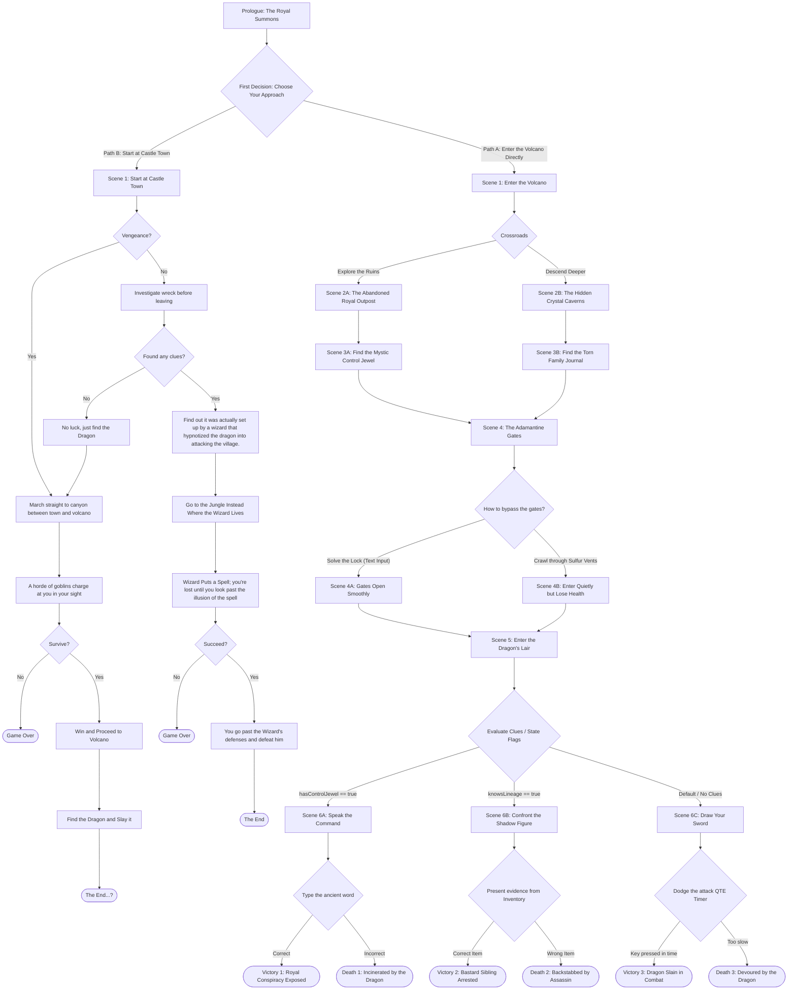

# Hero Quest

## Team Members and Roles

This project is structured around a dual-branch architecture. The player's very first decision splits the game into two distinct storylines, allowing each team member to take full ownership of their own narrative, HTML/CSS structure, and interactive JavaScript features.

* **John Roberts**
  * **Storyline Ownership:** Branch A (The Volcano Mystery & Dragon Hunt)
  * **Responsibilities:** Narrative design, Mermaid flowchart architecture, state flag tracking, inventory array logic, text-input puzzle validation, and Quick Time Event (QTE) timer mechanics for Branch A.
* **Zachary Villard**
  * **Storyline Ownership:** Branch B (Castle Town Investigation, Goblin Ambush & The Wizard's Jungle)
  * **Responsibilities:** Narrative design, branching flowchart integration, HTML/CSS layout, and interactive JavaScript mechanics for Branch B.
* **Shared Responsibilities**
  * GitHub repository management, branch maintenance (`main`, `development`, and individual feature branches), peer code reviews via Pull Requests, and shared entry-screen styling.

---

## Application Overview

**Hero Quest** is a browser-based interactive fantasy/mystery adventure game built with HTML, CSS, and JavaScript.

### Story Premise
A young swordsman trained by his older brother loses everything when a dragon attacks their village, slaying his brother and plundering the settlement's gold and jewels. Months later, with the village's economy in ruins, the Royal Family tasks the young swordsman with tracking down the dragon and recovering the stolen royal jewels.

At the outset of the journey, the player makes a pivotal first decision that determines which path—and which mystery—they will uncover:
* **Branch A (Volcano Descent):** The swordsman heads straight into the dragon's volcano lair, uncovering hidden clues, royal conspiracies, and family secrets that lead to three distinct victory endings—each guarded by a high-stakes failure condition.
* **Branch B (Castle Town):** The swordsman begins in Castle Town, choosing between immediate vengeance—fighting through a goblin ambush in the canyon to slay the dragon—or investigating the wreckage to uncover a wizard who hypnotized the dragon, leading to a showdown in the jungle against the wizard's illusions.

### Gameplay & Navigation
* **Branching Choices:** Players navigate the story by making decisions at key crossroads, directly altering the narrative path and available endings.
* **Interactive Mechanics:** Depending on the path chosen, players will encounter text-input riddles, inventory management, health/stat tracking, and timed Quick Time Events (QTEs). *(Specific UI controls and navigation rules will be finalized during the build phase.)*

---

## Story Flowchart

The flowchart below outlines the opening split between both team members' storylines and maps out the complete branching structure across both paths (45 nodes total).

